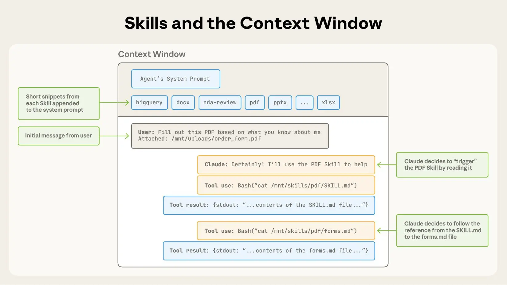
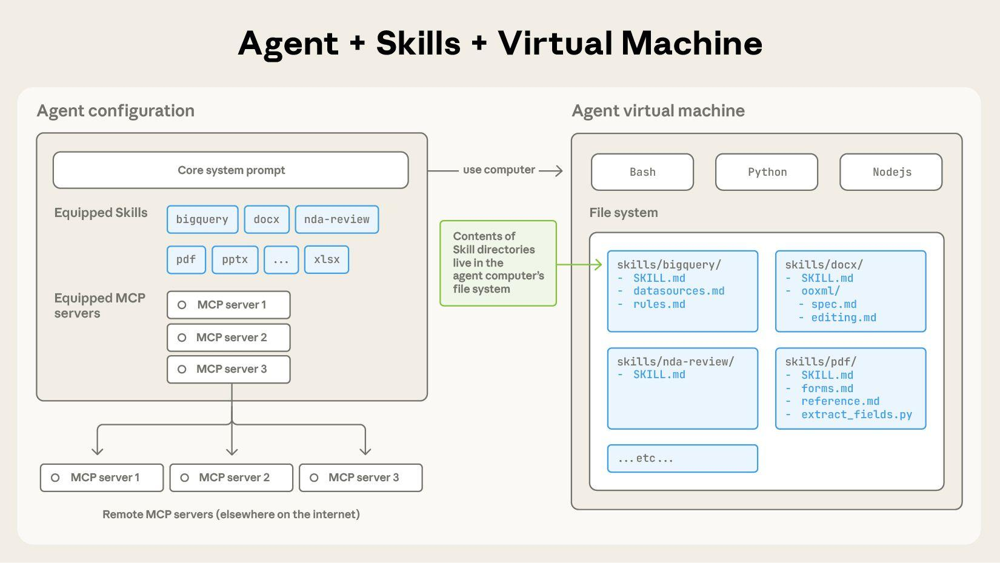

# Skills

A repository of personal skills for AI agents.

## Installation using CLI tool

The [skills.sh](https://skills.sh) CLI tool is used for installation:

```bash
# Install all skills from the repository
npx skills add https://github.com/nikita-safonov/skills.git

# View available skills without installing
npx skills add https://github.com/nikita-safonov/skills.git --list

# Install a specific skill
npx skills add https://github.com/nikita-safonov/skills.git --skill git-commit

# Install multiple skills
npx skills add https://github.com/nikita-safonov/skills.git --skill git-commit --skill git-branch

# Global installation (available in all projects)
npx skills add https://github.com/nikita-safonov/skills.git -g

# Install for a specific agent
npx skills add https://github.com/nikita-safonov/skills.git -a opencode
```

### Supported Agents

The CLI automatically detects installed agents:

- OpenCode
- Claude Code
- Z.ai
- Cursor
- Codex
- Cline
- GitHub Copilot
- [and 30+ others](https://github.com/vercel-labs/skills#supported-agents)

### Main Commands

| Command | Description |
| --- | --- |
| `npx skills add <source>` | Install skills from a repository |
| `npx skills list` | Show installed skills |
| `npx skills find [query]` | Search for skills |
| `npx skills remove [skills]` | Remove skills |
| `npx skills check` | Check for updates |
| `npx skills update` | Update all skills |

### Symlink for Multiple Agents

During interactive installation, the CLI will ask you to choose an installation method:

| Method | Description |
| --- | --- |
| **Symlink** (recommended) | Creates symlinks from each agent to a single copy of the skills. One source of truth, easy to update. |
| **Copy** | Creates independent copies for each agent. Use this if symlinks are not supported. |

If you work with multiple agents (OpenCode, Z.ai, Cursor, Claude Code, etc.), using **Symlink** is recommended — this
way all agents will use the same skills.

> **Important:** When using symlink in a project, don't forget to add agent folders to `.gitignore` if you don't want to
> commit the symlinks:

```plaintext
.opencode/skills/
.zai/skills/
.cursor/skills/
.claude/skills/
```

### Interactive Installation (Recommended)

```bash
npx skills add https://github.com/nikita-safonov/skills.git
```

Skills are installed in `./<agent>/skills/` and can be committed to the project repository.

### Global Installation (for personal use)

```bash
npx skills add https://github.com/nikita-safonov/skills.git -g
```

Skills are installed in `~/<agent>/skills/` and are available in all projects.

### Non-interactive Installation (for CI/CD)

```bash
npx skills add https://github.com/nikita-safonov/skills.git --skill pylines -g -a opencode -y
```

## Native Installation in Claude Code

Connect the repository as a source for remote plugins. This allows you to update skills with a single command.

1. **Add marketplace:**

    ```bash
    /plugin marketplace add https://marketplace-
    ```

2. **View available plugins:**

    ```bash
    /plugin search
    ```

3. **Install a plugin:**

    ```bash
    # Install the core skill set
    /plugin install skill-name --scope user
    ```

    Available scopes:
    - `user` — for personal use (recommended)
    - `project` — for the entire project team
    - `local` — only for the current directory

## Available Skills

Skills are organized by development domains. Each category has its own documentation with recommended tools,
alternatives, installation commands, and usage guidelines.

| Category | Description | Documentation |
| --- | --- | --- |
| Common | Full git, code review | [Common Skills](./COMMON.md) |
| Frontend | UI/UX design, animations, Fronted Code excellence. | [Frontend Skills](./FRONTEND.md) |
| Backend | Backend development and architecture. | [Backend Skills](./BACKEND.md) |

---

## ❓ FAQ (Frequently Asked Questions)

### Why are "skills" located in both `skills/` and inside `plugins/.../skills/`?

The `skills/` folder in the root is intended for general, atomic skills that are assembled into the base
`ai-platform-skills` plugin. Plugins in the `plugins/` folder are self-contained and can be distributed separately, so
they contain their own skills inside them.

### What are Skills and Agents?

**Skills** are capabilities invoked by the model that extend Claude Code's functionality. Unlike slash commands, which
require explicit user activation, Skills are triggered by Claude automatically based on context and the Skill's
description.



Each Skill consists of a `SKILL.md` file containing:

- YAML frontmatter with name, description, and metadata.
- Detailed instructions for Claude.
- Optional helper files (scripts, templates, reference materials).

**Agents** are specialized instances of Claude that can be called by the main Claude to perform specific types of work.
They run independently, having their own context, and can use other models optimized for their tasks.



Each Agent consists of an `AGENT.md` file containing:

- YAML frontmatter (name, description, model selection).
- Specialized instructions and constraints.
- Decision-making frameworks for their domain.

Skills and Agents work together: Skills can orchestrate when to call Agents, and Agents can use Skills while performing
their tasks.

---

### What are Plugins?

**Plugins** are complex distribution packages that extend Claude Code's capabilities by combining multiple components.
While a Skill is a single capability, a Plugin acts as a container that can deliver Skills, Agents, Hooks, and external
integrations in a single installation unit.

Each Plugin consists of a root directory containing:

- **Manifest File** (`.claude-plugin/plugin.json`): Mandatory metadata, including plugin name, version, author, and
  component paths.
- **Component Directories**: Standardized folders for `skills/`, `agents/`, or `commands/`.
- **Protocol Configurations**: Optional files like `.mcp.json` (for Model Context Protocol servers) or `.lsp.json` (for
  Language Server Protocol intelligence).

**Plugin Capabilities:**

- **Slash Commands**: Plugins create shortcuts like `/name` that can be invoked manually by the user or automatically
  via Claude.
- **Hooks**: Event handlers that react to the Claude Code lifecycle (e.g., running a script after using a tool or before
  ending a session).
- **External Integration**: Built-in MCP and LSP servers provide real-time code diagnostics, navigation, and connection
  to external databases or APIs.

Plugins are managed via **Scopes** (`user`, `project`, or `local`), allowing them to be personal, shared with a team via
version control, or restricted to a specific environment. Upon installation, Claude Code copies the plugin to a secure
cache directory where its manifest is validated, and commands are registered in the global namespace.

## Documentation

- [skills.sh](https://skills.sh) — skills catalog
- [CLI Documentation](https://github.com/vercel-labs/skills) — full documentation
- [Agent Skills Specification](https://agentskills.io) — format specification
- [Plugin Documentation by Anthropic](https://code.claude.com/docs/en/plugins) — description of working with plugins in
  Claude Code
